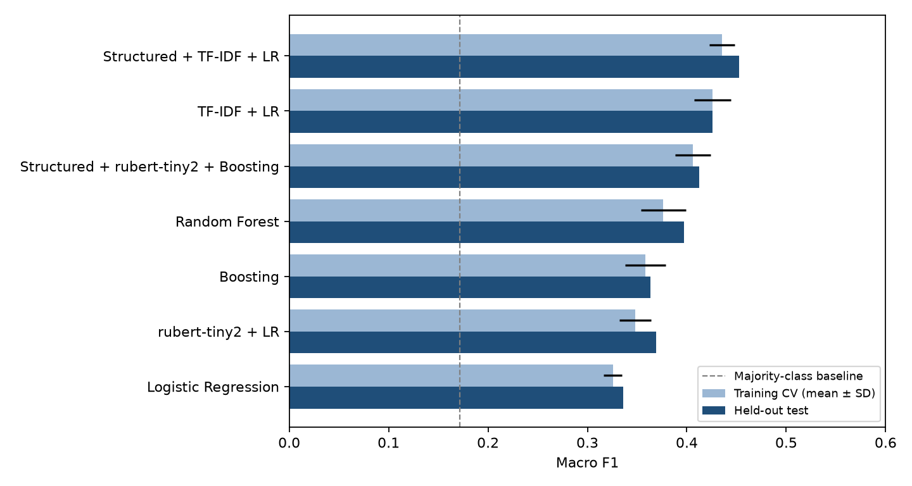
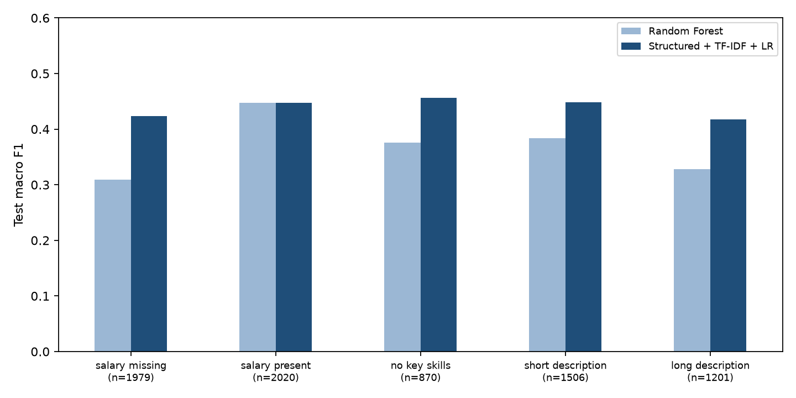
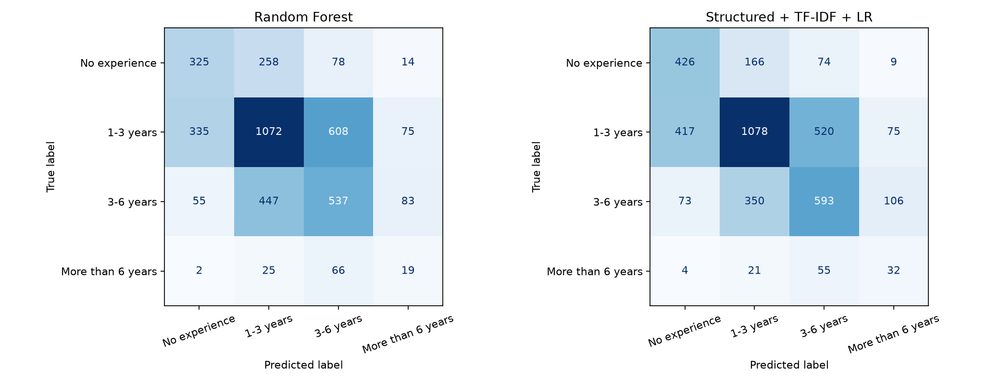

# Predicting Required Experience from IT Job Postings: Does the Vacancy Text Help?

**Final project report.** Machine Learning Algorithms, Astana IT University
Zholdubayev Diyar and Galymzhan Turemuratov

---

## 1. Question

When an employer publishes a vacancy on hh.ru, they choose how much experience they require from four options: *no experience*, *1–3 years*, *3–6 years* or *more than 6 years*. We ask two questions:

1. How well can this requirement be predicted from the structured fields of a vacancy (salary, key skills, schedule, employment type, city)?
2. Does the vacancy **text**, read by a text model, add information beyond those fields? Our own TF-IDF model and a pretrained Russian sentence encoder (rubert-tiny2) are compared.

A useful answer has two parts: whether the text helps, and *for which vacancies* it helps.

## 2. What changed since the Midterm and Endterm, and why

| Earlier weakness | What we did in the Final |
| --- | --- |
| The Midterm/Endterm dataset (1,250 vacancies) was **synthetic**. It was generated from templates, even though the Midterm README described it as collected from an API. | We moved to **real** vacancies: the public IEEE DataPort dataset collected from the hh.ru API (Section 4). |
| Junior/Middle/Senior labels came from a **heuristic rule** applied to the title and experience fields. | The target is now `experience_id`, which **the employer chose**. We do not construct the label. |
| Descriptions in the synthetic data copied the title, so length features leaked the label. | All text is **masked** before modelling: the title and every explicit experience or seniority phrase are removed (Section 5.2). |
| The Endterm found that rows **without salary** had about 3× more errors (19/60 vs 19/190), and the Senior class was weakest. The Endterm plan was to add description text with title clues masked. | We test this hypothesis directly. Does text help most when salary is missing, and does it help the most senior class? (Section 6.3) |

Because the data changed, the Final uses new objects and a new saved split, not the Endterm split. The Endterm results were on synthetic data, so carrying that split forward would have kept a dataset that does not answer a real question. The new split is saved by ID and fixed in the same way as before (Section 4.3).

## 3. Existing solutions

- **Experience-level classification of job descriptions.** Liang et al. (2026) predict experience levels (Entry/Mid/Senior) from recruitment texts. They compare rule-based systems, a TF-IDF baseline, a "Section-Aware BERT" that encodes the title, responsibilities and requirements separately, and few-shot and fine-tuned LLMs. They report that using the text's structure helps, especially when titles are ambiguous. They also report that the Mid level has blurred boundaries with its neighbours, which matches our confusion between adjacent classes. Their task is the closest to ours. Differences: we hide the title, use the employer's own hh.ru category as the label, and work with Russian texts.
- **TF-IDF vs transformer embeddings for job grading.** Jalilian et al. (2026, ACL Industry Track) predict job grades and salaries from job descriptions. For **grade** prediction, a tuned TF-IDF + XGBoost model was their best. Transformer embeddings won only for salary. We see the same pattern: for an ordinal "level" target, TF-IDF beats a frozen sentence encoder (Section 6.4).
- **Text of postings predicts pay.** Bana (reported by Stanford HAI, 2022) trained BERT on more than 800,000 US job postings. Using the posting text, salaries were predicted accurately 87% of the time, compared with 69% when using only the job title and location. This supports our hypothesis that the text carries information that structured fields miss.
- **The data source.** Bersenev et al. (2021) published about 3 million hh.ru IT vacancies from 2006–2020, collected through the public hh.ru API, for analysing IT trends and designing educational programmes. We use their 2020 file.
- **The pretrained component.** rubert-tiny2 (`cointegrated/rubert-tiny2`, MIT licence) is a small (29.4M-parameter) Russian BERT encoder. It is designed to produce sentence embeddings to be used as-is or fine-tuned. We chose it because it runs on a laptop CPU, which a larger encoder would not do with 20,000 long texts on our 8 GB machine.

**How this shaped our choices.** Prior work suggests that (a) TF-IDF is a strong, not a weak, baseline for level/grade targets, (b) titles can dominate, and (c) adjacent levels are hard to separate. So we compare against TF-IDF trained by ourselves, remove the title to measure what the *rest* of the text adds, and report where errors fall, not only the overall score.

## 4. Data

### 4.1 Source and rights
- **Dataset:** Bersenev, Sozykin, Shadrin, Koshelev, Kuklin, Aksenov, *IT vacancies from hh.ru, 2006–2020*, IEEE DataPort, 2021, doi:10.21227/6naz-wb22.
- **Licence:** Creative Commons Attribution 4.0 (CC BY 4.0). The authors collected the data through the public hh.ru API. Downloading needs a free IEEE account.
- **Our use:** we downloaded the 2020 file `vacancies_2020.csv.gz` (558 MB, 56 columns). CC BY allows us to redistribute our 20,000-row sample with attribution, so the sample is included in the submission. The full file is not included because of its size, and `data/README.md` explains how to download it.
- We did not scrape hh.ru, and we did not use any personal contact fields (`contacts`, addresses).

### 4.2 Objects, filters and missing inputs
- **An object** is one vacancy, identified by its hh.ru `id`. The text (`description`) is a field of the same record, so no matching between sources is needed and every object has its text.
- **Filters**, applied in `src/prepare_data.py`:
  - `experience_id` is one of the four labels;
  - the description has at least 200 characters. This is the only place where missing or very short text is handled: such vacancies are excluded, not imputed;
  - duplicate IDs and exactly duplicated descriptions (reposts) are removed.
- **Size:** 587,493 vacancies passed the filters, and 390,967 remained after de-duplication.
- **Sample:** a fixed 20,000-vacancy sample, stratified by label with seed 42, so it keeps the real class balance.
- **Class balance** (test set): 1–3 years 52.3%, 3–6 years 28.1%, no experience 16.9%, more than 6 years 2.8%.
- **Missing structured inputs** are common: salary is missing in 49.5% of test vacancies, and key skills are empty in 21.8%. Missing salary gets the training-fold median plus a "salary missing" flag. Non-rouble salaries (about 5% of rows) are flagged and treated as missing in the salary value.

### 4.3 Saved split
- The test set is 3,999 vacancies (20%), and the training set is 16,001.
- The split uses `StratifiedGroupKFold` **grouped by employer**: no employer appears in both train and test (8,256 employers in train, 2,060 in test). Large employers post many similar vacancies with the same "about us" text. A random split would let a text model memorise company boilerplate and look better than it is.
- Cross-validation on the training set is grouped by employer in the same way.
- The sample and the split are saved as `data/processed/vacancies_sample.csv.gz`, `train_ids.csv` and `test_ids.csv`, with SHA-256 hashes in `manifest.json`. Every training and evaluation run checks these hashes first, and `prepare_data` refuses to overwrite an existing split.

## 5. Methods

### 5.1 Structured-feature models (the baseline to beat)
- **Features:** log salary midpoint (roubles only), salary-missing and other-currency flags, number of key skills, description length in words, schedule, employment type, whether salary is gross, city (cities with fewer than 30 training vacancies are grouped together), and the 60 most frequent key skills (learned from training data only).
- **Not used:** the title and the employer.
- **Models:** majority-class Dummy, Logistic Regression, Random Forest and Histogram Gradient Boosting. Each is tuned with a grid search under 5-fold, employer-grouped cross-validation on the training set. The search covers regularisation, depth and leaf settings, learning rate and class weights.

### 5.2 Text preparation and leakage control
Many descriptions state the answer directly, for example «опыт работы от 3 лет», «без опыта» or «Senior». Before any text model sees a description, `mask_text` removes:
- the vacancy title;
- numeric experience phrases together with their quantifier, including Russian number forms (3х, 3-х, 5-ти, «от 3 (трёх) лет», «не менее 2 лет», «1–3 года», «5+ years»);
- word forms («от трёх лет», «более года»);
- «без опыта», and phrases saying experience is or is not required («опыт … приветствуется», «не обязателен»);
- seniority words (junior, middle, senior, lead, стажёр, ведущий, старший, младший, тимлид…).

**How we checked it:**
1. Unit tests cover each form.
2. We count how often each pattern fires. Numeric experience phrases appeared in **44.2%** of training descriptions and seniority words in 17.5%, so masking is essential.
3. We inspect the strongest TF-IDF terms of the training-set model for each class.

The first version of the masking missed forms like «от 3-х лет» and «не менее …». Check 3 exposed this: terms such as «3х лет» and «от лет» were among the top terms. We fixed the patterns, added tests, and **retrained every model from scratch**. Section 8 describes the effect.

### 5.3 Text models
- **Our own simple model:** TF-IDF on masked text (unigrams and bigrams, up to 20,000 terms, fitted inside each training fold) with Logistic Regression.
- **Pretrained (deep-learning) component:** frozen rubert-tiny2 sentence embeddings (312 dimensions, first 512 tokens) with Logistic Regression.
  - The encoder is not fine-tuned and learns nothing from our labels, so embeddings are computed once for all vacancies. Only the classifier on top is trained, on training data only.
  - It runs on the CPU, because on our 8 GB Apple M2 the GPU (MPS) ran out of memory.
- **Combined models:**
  - structured features + TF-IDF + Logistic Regression;
  - structured features + rubert-tiny2 embeddings + Gradient Boosting.

### 5.4 Selection and metric
- **Metric:** macro F1. It gives the four classes equal weight, so a model cannot look good by ignoring the 2.8% "more than 6 years" class. Accuracy is reported but not used: always predicting "1–3 years" already gives 52% accuracy.
- **Selection:** every model and every hyperparameter is chosen by training-set cross-validation macro F1. The test set is used only in `src/evaluate.py` for reporting.
- **Comparing two models:** we compare the best structured model with the best text-containing model, both selected by CV, on the same 3,999 test vacancies. The significance test is an exact McNemar test.

## 6. Results

### 6.1 Overall comparison

| Model | Input | CV macro F1 | Test macro F1 | Test accuracy |
| --- | --- | --- | --- | --- |
| **Structured + TF-IDF + LR** | fields + text | 0.435 ± 0.013 | **0.452** | 0.532 |
| TF-IDF + LR (own) | text | 0.426 ± 0.019 | 0.426 | 0.514 |
| Structured + rubert-tiny2 + Boosting | fields + text | 0.406 ± 0.018 | 0.413 | 0.490 |
| Random Forest (best structured) | fields | 0.376 ± 0.023 | 0.397 | 0.488 |
| Gradient Boosting | fields | 0.358 ± 0.020 | 0.364 | 0.426 |
| rubert-tiny2 + LR (pretrained) | text | 0.348 ± 0.016 | 0.369 | 0.559 |
| Logistic Regression | fields | 0.326 ± 0.009 | 0.336 | 0.551 |
| Dummy (majority class) | none | 0.172 | 0.172 | 0.523 |

CV values are the mean ± standard deviation over five employer-grouped folds. They describe fold-to-fold variation and are not confidence intervals. Test scores and the CV ranking agree, and test scores are within about 0.02 of CV.

### 6.2 Does the text add value? Yes.
- **Text alone beats the structured fields.** TF-IDF + LR on masked text (0.426) beats the best structured model, Random Forest (0.397).
- **Combining helps a little more:** 0.452.
- **The gain is statistically significant.** On the same test vacancies, the combined model is right where Random Forest is wrong 808 times, and the reverse happens 632 times. The exact McNemar test gives p ≈ 3.9 × 10⁻⁶.

Per-class F1 on the test set:

| Class | Random Forest | Structured + TF-IDF + LR |
| --- | --- | --- |
| No experience | 0.467 | 0.534 |
| 1–3 years | 0.551 | 0.582 |
| 3–6 years | 0.445 | 0.502 |
| More than 6 years | 0.125 | 0.192 |

Every class improves. The largest gain is for *no experience*: recall rises from 0.48 to 0.63. This is because entry-level postings use recognisable language such as «научим», «обучение», «начинающего» and «желание развиваться». These words are among the strongest TF-IDF terms for that class.

### 6.3 Testing the Endterm hypothesis: where does the text help?

| Test subgroup | n | Random Forest | + Text | Gain |
| --- | --- | --- | --- | --- |
| Salary missing | 1,979 | 0.309 | 0.424 | **+0.115** |
| Salary present | 2,020 | 0.447 | 0.447 | 0.000 |
| No key skills | 870 | 0.375 | 0.456 | +0.081 |
| Short description | 1,506 | 0.383 | 0.448 | +0.065 |
| Long description | 1,201 | 0.328 | 0.417 | +0.089 |

The hypothesis is **supported**.
- **Salary was the weak point named in the Endterm.** Without salary, the structured model loses most of its signal: macro F1 falls from 0.447 to 0.309. The text recovers almost all of that, to 0.424.
- **When salary is present, the text adds nothing measurable** (0.447 in both cases). Salary and the text carry overlapping information about seniority, and the text matters when the salary is absent.
- **The same happens when key skills are missing** (+0.081).
- **The rarest, most senior class improves but stays weak.** F1 rises from 0.125 to 0.192, and recall from 0.17 to 0.29. This was the other Endterm concern.

### 6.4 Pretrained encoder vs our own TF-IDF model
- **The pretrained component lost.** rubert-tiny2 + LR scored 0.348 CV and 0.369 test, against 0.426 for TF-IDF + LR.
- **Its high accuracy is misleading.** Its test accuracy of 0.559 is the highest in the table, but it gets there by predicting mostly the majority class: recall is 0.81 for 1–3 years but 0.31 for no experience and 0.02 for more than 6 years. Macro F1 exposes this.
- **Adding the embeddings to the structured fields helps** (0.413 vs 0.397) but does less than adding TF-IDF (0.452).

**Why we think it lost:**
1. **The encoder is frozen and general-purpose.** It compresses a whole description into 312 numbers that capture the general topic («this is a backend job»). The level is signalled by specific words (managing a team, architecture, «научим»), and TF-IDF can weight those directly.
2. **It reads only the first 512 tokens.** Requirements are often at the end of a description.
3. **The finding matches prior work.** Jalilian et al. (2026) also found TF-IDF best for grade prediction.

Fine-tuning the encoder on our labels might change this result. We did not do it because of hardware limits (Section 8).

### 6.5 Error analysis with real test vacancies
- **Most errors are between adjacent levels.** Of the combined model's 1,870 test errors, 86% are off by exactly one level, for example 1–3 predicted as 3–6. The two-step errors are rare: no experience predicted as 6+ happened 9 times. The confusion matrices (`results/figures/confusion_matrices.png`) show most mistakes on the band next to the diagonal.
- **The boundary is fuzzy in the data itself.** Employers posting similar jobs often choose neighbouring categories. The largest single confusion is 1–3 vs 3–6 years (520 and 350 test vacancies).

Real examples from `results/tables/errors_best_structured.csv`:

| ID | Title (not used by models) | True | Random Forest | + Text | Comment |
| --- | --- | --- | --- | --- | --- |
| 38034824 | Администратор компьютерного клуба | No experience | 1–3 | **No experience** | Salary missing. The text describes greeting guests and explaining tariffs, a front-desk job, and the text model reads that. |
| 35544251 | Аккаунт-менеджер / менеджер по работе с клиентами | No experience | 3–6 | **No experience** | Salary missing. The text stresses «обучаемость» and simple tasks. |
| 40352066 | Начальник центра технической эксплуатации телекоммуникаций | 3–6 | 1–3 | **3–6** | Salary missing. Duties about running a centre and planning modernisation signal seniority. |
| 38477240 | Начальник отдела сопровождения сервисов и систем BI | More than 6 | 1–3 | 1–3 | Both wrong. The strongest clue («Начальник отдела») is in the title, which we hide. The duties alone look like ordinary support work. |
| 35180911 | Веб-разработчик .NET | More than 6 | 3–6 | 3–6 | Both off by one. The text asks for «хороший опыт» with the Microsoft stack, which does not say how much. |
| 38715353 | Специалист ИТ | More than 6 | 1–3 | 1–3 | Both wrong. A general IT-support job where the employer asked for 6+ years. Nothing in the text suggests it. |

**What the errors show:**
- **The text fixes errors where the fields are empty.** It reads the nature of the job: front-desk, trainee-friendly or managerial.
- **The remaining "6+ years" errors** come from three causes: the seniority signal is in the hidden title, the text says "good experience" without numbers, or the employer's requirement is not reflected in the duties at all. The last case is a limit of the label, not of the model.

## 7. The local app

`app/app.py` is a Streamlit app, started with `streamlit run app/app.py`.

**What it does:**
1. Loads the saved pipelines from `models/` (`joblib`) and the model list from `models/registry.json`. The default model is the one with the best CV score, Structured + TF-IDF + LR.
2. Accepts a new vacancy: title, salary from/to and currency, schedule, employment type, gross/net, city, key skills and description.
3. Passes the input through **the same** `build_frame` → `mask_text` → saved preprocessing path used in training. For embedding models, it also runs the same rubert-tiny2 encoder.
4. Shows the predicted experience level, the probability of each class, and an expander showing what the model actually received: the masked text, parsed skills and numeric features.

**How it handles bad input:**
- If "salary from" is larger than "salary to", it shows an error.
- If both the description and the skills are empty, it asks for input instead of guessing.
- If the description is empty for a text model, it warns that the prediction relies on the other fields.
- Salary is optional.

Any model in the registry can be selected, so the comparison can be shown live at the defense.

## 8. Limitations

- **The labels are the employer's choice, which is itself noisy.** Similar jobs get neighbouring categories, which caps achievable accuracy. Most of our errors are one level off.
- **The data is from one year (2020) and one site (hh.ru),** mostly Russian employers. We make no claim about other years, other countries or the Kazakhstan market specifically.
- **"More than 6 years" is rare** (112 test vacancies). Its F1 is low and uncertain.
- **Masking is pattern-based.** Some indirect cues remain on purpose, because they are normal job content and not statements of the label: «опыт управления», «стаж работы», «научим». An unusual phrasing of an experience requirement may still slip through.
- **Masking also over-removes.** «Опыт с Kafka приветствуется» is removed as a whole, so a skill name can be lost from the text. It still reaches the structured model through key skills when the employer lists it there. Title removal is an exact substring match, so an inflected title can leave word fragments.
- **The first masking version leaked some experience phrases** (Section 5.2). Before the fix, the leaky models had been evaluated on the test set once. The fix changed only the masking. No model, parameter or feature choice was changed in response to test scores, and all reported numbers come from the corrected run. The leak had inflated CV slightly: TF-IDF + LR scored 0.433 before the fix and 0.426 after.
- **The pretrained encoder was used frozen, on the CPU, reading 512 tokens.** Fine-tuning, or a larger encoder, might perform better. We could not test this on an 8 GB laptop within the project.
- **The title was excluded** so we could measure what the rest of the text adds. A production system would use the title, and prior work suggests it is a strong signal.
- **One fixed split.** CV standard deviations (about 0.01–0.02) show the scale of variation. Differences smaller than that between models should not be over-interpreted.

## 9. Reproducibility

- **Setup.** Python 3.12. `requirements.txt` pins direct dependencies, and `requirements-lock.txt` records the full tested environment. The saved `.joblib` models need the same scikit-learn version (1.9.1).
- **Run order:**
  1. `python -m src.prepare_data`, which needs the raw file;
  2. `python -m src.train_structured`;
  3. `python -m src.train_text`;
  4. `python -m src.evaluate`;
  5. `python -m pytest -q` (39 tests).
- **Notebook.** `notebooks/Final.ipynb` is executed and saved with its outputs. It reloads the saved models, recomputes every test metric and checks them against the saved tables.
- **Seed.** Seed 42 is used for sampling, the split, CV folds and every model.
- **Run-to-run variation.**
  - With the saved split, the pipeline is deterministic on the same machine and library versions. Rerunning `evaluate` reproduced identical numbers.
  - Small differences can appear on other hardware or library versions. Floating-point order in the encoder and in tree building can shift a few predictions.
  - Our timings on an Apple M2 (8 GB, CPU): about 3 minutes for the structured models, 14 minutes for the text models including encoding, and about 30 seconds for `prepare_data`.

## 10. Who did what

This section uses the same format as the Endterm: what was done in this stage, the earlier history kept separate, and no work credited without a record of it.

**Final stage**
- **Galymzhan Turemuratov** directed the Final. He:
  - checked the origin of the earlier dataset and found it was synthetic;
  - required real data, chose the IEEE DataPort hh.ru dataset and downloaded it;
  - chose the target (the employer's `experience_id`) and the project layout;
  - directed the implementation of data preparation, models, evaluation, the app, the notebook, this report, the slides and the packaging.
- **Zholdubayev Diyar's** new Final-stage contribution is not recorded in this project, so none is claimed here.

**Earlier stages (as declared in the earlier documentation, not re-verified)**
- **Midterm:** the original README credits data collection and preprocessing to Galymzhan, and the baselines and presentation to Diyar.
- **Endterm:** Diyar requested and directed the continuation.

**Defense (a plan, with the same split as the Endterm)**
- **Diyar presents:** the question, the changes since the Endterm, the data and the live app demo (slides 1–4 and 11).
- **Galymzhan presents:** leakage control, models, results, the Endterm hypothesis, the pretrained-model comparison, errors and conclusions (slides 5–10 and 12).
- Both answer questions on any part of the project.

## 11. AI tools

An AI coding assistant was used for implementation and drafting: Claude Code in the Final, and OpenAI Codex in the Endterm. All reported numbers come from executed code.

## 12. References

1. Bersenev, A., Sozykin, A., Shadrin, D., Koshelev, A., Kuklin, E., Aksenov, A. (2021). *IT vacancies from hh.ru, 2006–2020.* IEEE DataPort. doi:10.21227/6naz-wb22. https://ieee-dataport.org/open-access/it-vacancies-hhru-2006-2020
2. Liang, C., Wu, E., Wang, S., You, Y. (2026). *Evaluating Modeling Approaches for Experience-Level Classification in Job Description.* arXiv:2610.04304. https://arxiv.org/abs/2610.04304
3. Jalilian, S., van Weeren, N., Shokri, M., Bijl, T., Verberne, S. (2026). *Enhancing Job Evaluation with Data Augmentation and Text Classification.* Proceedings of ACL 2026 (Industry Track), pp. 872–883. https://aclanthology.org/2026.acl-industry.59.pdf
4. Miller, K. (2022, January 10). *Words Matter: The Text of Online Job Postings Can Predict Salaries* (on research by S. Bana). Stanford HAI. https://hai.stanford.edu/news/words-matter-text-online-job-postings-can-predict-salaries
5. cointegrated. *rubert-tiny2* (model card, MIT licence). Hugging Face. https://huggingface.co/cointegrated/rubert-tiny2
